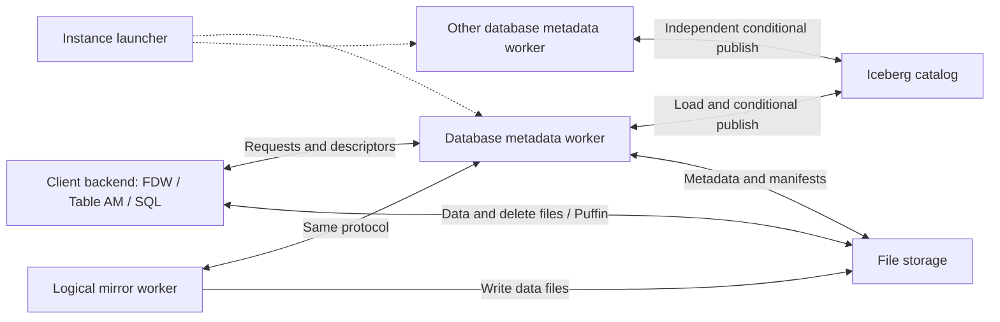

<!--
Licensed under the Apache License, Version 2.0 (the "License");
you may not use this file except in compliance with the License.
You may obtain a copy of the License at

    http://www.apache.org/licenses/LICENSE-2.0

Unless required by applicable law or agreed to in writing, software
distributed under the License is distributed on an "AS IS" BASIS,
WITHOUT WARRANTIES OR CONDITIONS OF ANY KIND, either express or implied.
See the License for the specific language governing permissions and
limitations under the License.
-->

# Iceberg metadata service architecture

Status: proposal beyond the implemented [phase 1 worker foundation](../metadata-workers.md).
Phase 1 provides the launcher, per-database workers, and ping/echo transport.
Caching, scan planning, and transaction migration below are proposed, based on
`4e60434` and iceberg-cpp 0.4.0.

Use one resident metadata worker per explicitly enabled database and one
instance launcher. The worker owns Iceberg metadata access, planning, private
transactions, publication, and recovery. Client backends keep data-file I/O,
decoding, and PostgreSQL execution. Other databases and external engines may
access the same Iceberg tables concurrently.

The [transaction protocol](metadata-transactions.md) defines consistency,
publication, and recovery. The [placement rationale](metadata-worker-placement.md)
compares deployment alternatives. Per-database placement fits pgiceberg's local
configuration; PostgreSQL does not require it.

## Ownership

Iceberg metadata includes catalog state, metadata JSON, snapshots, manifests,
schemas, partition specs, properties, and maintenance operations. PostgreSQL
catalogs, ACLs, configuration, and relation bindings remain in the calling
backend's transaction. File writers generate Parquet footers, statistics, and
Puffin contents; the worker uses those materials to publish metadata.

Clients hold immutable, versioned descriptors, never shared C++ objects or
mutable catalog tables. A busy or unavailable worker causes a wait or an error;
clients do not fall back to loading, planning, publishing, or rolling back
metadata themselves. A scan with a complete local plan may continue.

The catalog and metadata files remain authoritative. Worker caches accelerate
access; a durable journal records unresolved local publications.

### Migration from the current code

| Current path | Target responsibility |
| --- | --- |
| `common/catalog.cc` | Backend resolves PostgreSQL configuration; worker owns catalog clients and version caches. |
| `fdw/fdw.cc::PgIcebergGetForeignRelSizeImpl` | Request estimates and schema descriptions from the worker. |
| `engine/iceberg_scan.cc::Init` | Move `NewScan` and `PlanFiles` to the worker; keep readers in the backend. |
| `engine/scan_state.cc::IterateScan` | Keep Arrow-to-`Datum` conversion and tuple slots in the backend. |
| `engine/modify_state.cc` | Backend writes files; worker owns `Pending*Change` application, private views, and Iceberg transactions. |
| `CommitPendingModifyChanges` / `engine/commit_recovery.cc` | Backend adapts PostgreSQL transaction events; worker publishes and owns recovery records. |
| `functions/`, Table AM DDL hooks | Route every Iceberg metadata operation through the worker. |
| `logical/logical.cc` | Use the same client protocol, preserving publish-before-slot-advance ordering. |

iceberg-cpp's `FileScanTask` and `FileScanTaskReader::Options` allow readers to
be constructed from FileIO, schema history, projection, name mapping, and reader
properties without a mutable catalog table. This is the planning/reading split.
The [three PostgreSQL surfaces](postgres-extension-surfaces.md) remain independent.

## Worker lifecycle

`shared_preload_libraries` registers a static launcher. The SIGHUP setting
`pgiceberg.metadata_databases` explicitly selects databases; queries do not
implicitly enable a service. The launcher uses shared PostgreSQL catalogs and a
registry for discovery, admission, start/stop, and restart backoff. Requests go
directly to the database worker.

Dynamic workers use `BGW_NEVER_RESTART`; the launcher alone decides when to
replace them. The postmaster may restart the static launcher. Registry identity
includes database OID, installation identity, and worker epoch. Short locked
transitions claim `STOPPED → STARTING → READY`, and workers verify ownership
before accepting requests. A heartbeat timeout alone must not create a second
publisher: confirm the old worker has exited before changing epochs.

After restart, the launcher reconciles live workers from shared identity and
process state. It cannot depend on its old private `BackgroundWorkerHandle`s or
reset the registry unconditionally. The journal also needs single-writer
ownership. Instance budgets cover all enabled workers, memory, and I/O, alongside
`max_worker_processes` consumers such as logical workers and other extensions.

Each worker connects once to its database, checks the extension version, and
reads committed configuration in short SPI transactions. Network I/O holds no
PostgreSQL configuration locks. Start at `BgWorkerStart_RecoveryFinished` and
publish or compensate only on a writable primary. Standby reads and failover
require a separate design.

The backend resolves configuration and ACLs under its own snapshot, then sends
an authorized `CatalogBinding`. This supports configuration created earlier in
the same transaction. Such bindings stay transaction-private. A worker's service
identity does not grant callers extra privileges.

Recovery reloads committed bindings and validates their identity and fingerprint.
Journal records store credential-source references, never passwords, tokens, or
secret-bearing URIs. Missing, changed, rolled-back, or expired bindings leave the
record in `WAITING_FOR_BINDING` until an authorized rebind. They do not prove a
publication failed.

Shared startup state contains only generations, slots, queue handles, and wakeup
state. Create catalog clients, FileIO, HTTP runtimes, and thread pools after fork;
audit `_PG_init` for postmaster-time initialization.

Disabling a database enters `DRAINING`: reject new transactions, let existing
ones finish, then terminate on timeout while retaining recovery records. Stop
the worker before dropping the database or extension. Forced removal leaves
detached records; a replacement database or installation must not claim them or
automatically delete external data. Enabled workers remain resident initially;
future idle shutdown must also account for read handles and unresolved work.

## Execution and transport

The main thread owns PostgreSQL calls, request ordering, object lifetimes, and
completion events. A bounded pool may perform pure C++ network I/O, manifest
planning, and commits after a dependency thread-safety audit. Each job exclusively
owns its mutable Iceberg objects. Publications for one physical table serialize
within a database; other tables may run concurrently. Catalog preconditions
handle cross-database and external writers.

SPI, MemoryContext operations, PostgreSQL errors, and interrupt checks stay on
the main thread. Reuse `pg_logger.cc`'s queued worker-thread logging, adding request
identity. PostgreSQL longjmp bypasses C++ destructors, so API boundaries require
error guards and explicit cleanup. A synchronous prototype establishes
correctness, not a throughput claim.

Use DSM and one request/response `shm_mq` pair per client. Each queue has one
sender and receiver; registration uses short registry locks and latches.
Messages carry protocol, session, worker, transaction, command, and operation
identities. Validate ownership against registered PostgreSQL process state,
rather than trusting a caller-supplied PID or role. SQL must not expose arbitrary
privileged RPC construction.

| Request family | Purpose |
| --- | --- |
| `BindCatalog`, `DescribeTable` | Authorized table identity, schema, estimates, and version. |
| `AcquireReadView`, `PlanScan`, `FetchTasks`, `ReleaseReadView` | Pin a version and stream bounded task pages. |
| `BeginWrite`, `AllocateFiles`, `StageChange`, `FinishCommand` | Reserve files and build command-visible private state. |
| `ReleaseSavepoint`, `RollbackSavepoint`, `ReconcileSubxacts` | Reconcile operation ownership before further work. |
| `Publish`, `GetCommitStatus`, `TransactionOutcomeHint` | Publish durably, resolve outcomes, and report PostgreSQL hints. |
| DDL, metadata inspection, reconcile, repair | Route all administration through the same service. |

RPCs operate per plan, task page, or completed file, never per row. Use
`DataTableScan::PlanFilesStream()` rather than accumulating a full `PlanFiles()`
vector for every scan. `shm_mq` copies data into its ring and may copy on receive;
DSM transport alone does not provide zero-copy access.

### Descriptors

A `ReadView` includes table UUID, metadata location/version, snapshot/ref,
schema/spec versions, projection, historical schema lookup, reader properties,
name mapping, and worker epoch. Snapshot ID alone is insufficient: schema and
property changes need not create snapshots.

A `FileTask` includes data and delete-file descriptors, partition/spec, size and
format, equality field IDs, Puffin offset/size, referenced data file, inherited
data sequence number and first row ID, and residual expressions. A path or a
manifest serialization alone may omit required reader state.

Use versioned, typed wire fields and field IDs, never pointers or C++ memory
layouts. Keep unsupported expressions and the existing qual recheck in
PostgreSQL; `FileScanTaskReader` does not guarantee complete residual filtering.

Binding/cache identity includes database, authorization, configuration generation,
and canonical catalog identity. Publication keys resolve aliases to the actual
catalog/tenant and table UUID. Secrets stay out of plans and logs. Direct file
readers still need storage credentials; isolating all credentials would require
a separate data-proxy design.

## Read and write flows

A new execution validates schema and obtains a read view independently of planner
estimates. The worker fixes its version, prunes manifests/files, and streams tasks.
The backend reconstructs read-only descriptors, creates FileIO/readers, reads
data and deletes, and converts Arrow batches to PostgreSQL tuples. Scan end,
cancellation, and backend exit release ownership.

By default, each statement's new public view checks the catalog head and reuses
cached parsing if unchanged. This preserves current freshness but may still
require a catalog round trip. A TTL would introduce bounded staleness and needs
an explicit policy. Statements pin their views. After the first write to a table,
reads use its fixed base plus completed private changes; they do not automatically
rebase. Historical reads remain separate. PostgreSQL `REPEATABLE READ` and
`SERIALIZABLE` add no Iceberg MVCC, SSI, or common heap/Iceberg snapshot.

For writes, the worker allocates file tokens before backend I/O, stages complete
file descriptors into a private transaction, and advances private visibility at
`FinishCommand`. Savepoints rebuild surviving operations. At `PRE_COMMIT`, the
backend waits for durable per-table publication results. Lost responses are
resolved by the original publication ID; they never justify repeating an append
or deleting files.

The [transaction protocol](metadata-transactions.md) owns the details: command
visibility, savepoints, conditional retries, journal barriers, FullXID recovery,
and compensation. It distinguishes `PG_TRANSACTION`, `IMMEDIATE_ADMIN`, and
`LOGICAL_BATCH`; DDL timing and logical publish-before-slot-advance ordering must
survive migration. Metadata inspection and explicit rollback also use the worker.
Ordinary Parquet/Avro file FDWs remain independent.

Read handles constrain this service's maintenance, not another database or an
external engine. Shared retention rules are still required. Initially, automatic
GC covers only provably unpublished owned files; full snapshot expiration and
orphan scans are explicit administration. A missing file fails the scan rather
than silently switching snapshots.

## Optional shared data cache

Keep backend data reads as the default. Sending every decoded batch through the
metadata worker adds copying, queue pressure, and central CPU load. A future
shared immutable batch cache can reuse downloads or decoding without making that
worker perform every cache miss. A backend with a fill token, or a separate
reader pool, can populate it.

| Boundary | What can be shared |
| --- | --- |
| iceberg-cpp → Arrow in one backend | `ArrowArrayStream` import can reuse buffers; earlier I/O, decompression, and delete filtering may still copy. |
| Across backends | Immutable payload buffers with process-independent descriptors and local Arrow wrappers. |
| Arrow → PostgreSQL executor | Current `IterateScan` still converts rows to `Datum`; strings, binary, UUID, and numeric values require PostgreSQL representations. |

The [Arrow C Data Interface](https://arrow.apache.org/docs/format/CDataInterface.html)
contains pointers and release callbacks for in-process exchange. A versioned
`SharedBatchDescriptor` needs segment handles, allocation generations, schema/row
counts, buffer offsets and lengths, and child/dictionary layouts. Do not share
C++ reference counts, callbacks, or virtual addresses.

iceberg-cpp 0.4.0's Parquet reader uses `arrow::default_memory_pool()` and exposes
no pool injection through `ReaderOptions` or `FileScanTaskReader::Options`.
Decoding privately and copying once into DSM is feasible; allocating final
outputs directly in DSM requires upstream or adapter changes through projection,
missing-column construction, and delete filtering. Uncompressed Arrow IPC can
supply a portable layout, but serialization may still copy.

Publish buffers only after initialization and synchronization. Pin before access;
reclaim through backend ownership records, including abnormal exits. Bound slow
consumers and refuse allocation or use local reads when all buffers are pinned.
Prefer caching raw file/row-group/column data and applying current deletes later.
A post-delete cache key must include read version, delete set, schema, projection,
and conversion semantics, plus authorization and file/object identity.

Measure catalog, manifest, download, decode, delete-filter, and tuple-conversion
costs separately. OS page caching is not a shared decoded-batch cache and does
not provide the same benefit for remote object reads.

## Failure handling and limits

Worker restart creates a new epoch and new queues; `shm_mq` endpoints cannot
simply be reassigned. Reject stale handles and operations. A complete local read
plan may survive a controlled restart; an incomplete task stream or lost private
write state fails its transaction. Hard worker crashes follow PostgreSQL's
instance recovery rules and may affect other sessions.

Retain durable publications after client loss, preserve files for unknown
outcomes, and pause only the affected recovery record when binding is unavailable.
Timeout and isolate stalled jobs without holding registry locks over network I/O.
Bound worker count, cache/transaction/message/DSM bytes, active handles, files,
and I/O jobs across the instance. Evict unpinned cache entries or reject work
before admission; reserve resources to finish already accepted publications.

Expose queue wait, RPC/catalog/planning latency, cache hit/miss, active handles,
private transactions, memory, unknown publications, and journal cleanup progress.
Local fsync journals are not PostgreSQL WAL and do not replicate automatically.
Failover recovery needs replicated receipts and publisher fencing; this proposal
covers local instance recovery only.

## Delivery and validation

| Phase | Deliverable | Required evidence |
| --- | --- | --- |
| 1: foundation (implemented) | Launcher, per-database workers, identity registry, ping/echo. | PostgreSQL 16/17/18; admission, cancel, disconnect, lifecycle, and restart. |
| 2: metadata reads | Catalog cache, describe/acquire/plan/inspect, backend readers. | Schema/task round trips, historical snapshots, field IDs/defaults, v2 deletes, v3 DVs. |
| 3: metadata updates | Private transactions, savepoints, publication, DDL, logical batches, journal. | Read-your-writes, external conflicts, deduplication, partial publication, PostgreSQL outcomes. |
| 4: recovery and capacity | Fault handling, admission, observability, baselines. | Lost ACKs, abort/crash boundaries, expired credentials/FullXIDs, long pins, bounded memory. |
| 5: optional shared cache | Choose after measurement. | Schema/delete-set isolation, consumer death, actual shared and copied bytes. |

Keep `metadata/client`, `launcher`, `worker`, and `protocol` separate from future
`catalog_store`, `transaction`, and `recovery` components. `engine/` retains file
readers/writers and PostgreSQL transaction adaptation; the service core does not
depend on FDW, Table AM, or logical callback layers.

Intermediate phases still contain old metadata paths. Full service mode requires
proof that every metadata entry point uses the worker, with no client fallback
or mixed publishers within a transaction. Any legacy rollout mode is selected
per deployment instance.

Before migration, prototype PostgreSQL lifecycle/command callbacks, complete
schema/task serialization, catalog retry preconditions, and cancellation of
side-effecting jobs. Fault-inject catalog success before receipt/ACK, multi-table
failure, PostgreSQL commit/abort, first-snapshot rollback, and recovery without a
client. Unprovable outcomes remain unknown.

Benchmark current and proposed paths for cold/warm metadata, local/S3 storage,
projection width, deletes, and concurrent reads/writes. Report throughput,
p95/p99 latency, private/shared memory, and copied bytes before choosing a cache.
Release notes must identify proposed behavior changes: forced local synchronous
commit for ordinary publications, independent logical-batch recovery, DDL mixing
restrictions, capability-gated conditional drop, and staged-create private reads.
