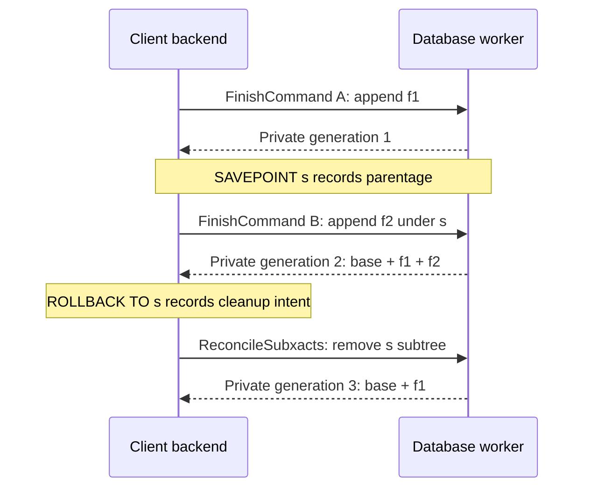

<!--
Licensed under the Apache License, Version 2.0 (the "License");
you may not use this file except in compliance with the License.
You may obtain a copy of the License at

    http://www.apache.org/licenses/LICENSE-2.0

Unless required by applicable law or agreed to in writing, software
distributed under the License is distributed on an "AS IS" BASIS,
WITHOUT WARRANTIES OR CONDITIONS OF ANY KIND, either express or implied.
See the License for the specific language governing permissions and
limitations under the License.
-->

# Metadata worker transaction protocol

Status: proposed transaction migration, based on `4e60434` and iceberg-cpp 0.4.0.
The implemented [worker foundation](../metadata-workers.md) provides process
management and ping/echo only. This document defines future messages, durability,
and recovery alongside the [architecture](metadata-backend.md). The
[current commit protocol](postgres-iceberg-commit.md) describes existing behavior.

## Invariants and publication modes

1. Backends write data/delete files; the database worker owns all Iceberg
   metadata reads and mutations. Clients hold no mutable catalog table or
   Iceberg transaction.
2. Private changes belong to one top-level PostgreSQL transaction. Issued read
   views are immutable versions, not references to metadata still being mutated.
3. Side effects have stable identities. Timeout, disconnect, and process exit
   do not prove that a publication failed.
4. Persist intent before a catalog attempt and results before success ACKs.
   Retain files whenever publication is possible.
5. COMMIT/ABORT and subtransaction callbacks never wait for network or queue
   space. The worker eventually completes cleanup.
6. Serialize same-table publication within a database. Catalog preconditions
   govern other databases and engines; cross-system atomicity is not provided.

| `publish_mode` | Publication point | If PostgreSQL later aborts |
| --- | --- | --- |
| `PG_TRANSACTION` | Top-level `PRE_COMMIT` for FDW/Table AM DML and staged Table AM DDL. | Clean unpublished work; safely compensate confirmed publications when possible, otherwise retain for repair. |
| `IMMEDIATE_ADMIN` | Inside existing immediate create/register/schema/rollback SQL functions. | Keep confirmed external effects; resolve unknown results through receipts. |
| `LOGICAL_BATCH` | Explicit flush before advancing the logical slot. | Keep published batches; deduplicate replay and advance the slot. Never apply ordinary PG-abort compensation. |

The first two preserve existing publication timing. Independent logical-batch
recovery is a proposed change: target durability must not depend on the mirror
worker's local transaction after source WAL may have been consumed.

## Identity and state ownership

| Identity | Contents and lifetime |
| --- | --- |
| `DatabaseIdentity` | PostgreSQL system identifier, database OID, persistent extension installation UUID. |
| `SessionId` | Database identity, PostgreSQL process slot, connection generation; never a bare PID. |
| `TxnId` | Session plus client transaction nonce; associate the caller's top-level FullXID on first write. |
| `StatementId` / `CommandId` | Monotonic execution identity and visibility boundary, including nested SPI parent identity. |
| `SubxactId` | Subtransaction and parent; retain ancestry and rollback tombstones. |
| `TableKey` | Actual catalog/tenant identity and table UUID; namespace/name before create. Ref is an operation argument. |
| `ReadViewId` | Table identity, complete metadata version, private generation, owner, worker epoch. |
| `OperationId` | Transaction and operation sequence, validated against a payload digest. |
| `PublishId` | Non-reusable random durable ID with mode, table list, and digest; survives worker epochs. |
| `FileToken` | Publication/transaction owner, unique URI, file kind, authorized binding, allocation generation. |

Installation UUIDs require new persistent metadata and explicit migration of old
logs. Table refs share one publication queue because schema/properties are
table-wide. Neither a local epoch nor a system identifier provides failover
fencing; cloned clusters and HA takeover are outside automatic recovery here.

The worker separates three objects: `CatalogStore` caches authorized clients and
immutable metadata; `TxnContext` holds bases, ordered operations, commands,
subtransactions, files, and private views; `PublishRecord` persists intent and
per-step receipts after the session disappears.

DML and staged DDL share one transaction adapter and operation sequence, rather
than depending on separate callback registration order. Different publication
modes use separate records. Errors report IDs of any immediate external effects
that remain after PostgreSQL abort.

## Read views and command visibility

| Access | View rule |
| --- | --- |
| Planning | Estimates and schema only; execution revalidates them. |
| Table not yet written by this transaction | Check external head on first access in each statement; aliases and repeated scans share it. |
| Table already written | Fixed first-write base plus completed, surviving commands; no automatic external rebase. |
| Explicit historical snapshot | Historical view without private changes. |
| Rescan or cursor fetch | Original pinned view, despite later commands or commits. |
| Incompatible schema change | Rebind by field ID or fail; never silently substitute a same-name column. |

These rules add no Iceberg transaction-level MVCC, SSI, or common heap/Iceberg
snapshot under PostgreSQL `REPEATABLE READ` or `SERIALIZABLE`.

Create `StatementId` lazily in an execution context, not from query text, prepared
statement name, or command counter alone. Nested SPI, triggers, and modifying
CTEs must follow actual command visibility. An UPDATE scan must not revisit its
own newly written files. `RETURNING` uses local execution results.

`StageChange` accepts material; `FinishCommand` atomically advances the private
view when the command becomes visible to later commands. Existing scans retain
their generation and file pins. Nested completed commands may become visible,
but parent failure still rolls back their subtransaction-owned operations.
Prototype these executor boundaries; reject unsupported nested writes before
file I/O. Read-only nesting shares its execution snapshot. WITH HOLD cursors must
materialize through PostgreSQL and release private handles before transaction end.

## Writes and savepoints

1. Assign the caller's top-level FullXID. `BeginWrite` validates authorization,
   identity, and read version, then fixes the table base.
2. `AllocateFiles` durably registers unique paths before returning write tokens.
3. Write and close files. Send tokens, complete descriptors, read version, and
   validation conditions in `StageChange`. Validate paths, format, schema/spec,
   and field IDs; arbitrary deletion URIs are not accepted.
4. Apply changes to an isolated candidate transaction. Replace private state
   only after the whole operation succeeds.
5. `FinishCommand` checks the operation set and digest, then advances generation.
   Duplicate requests return the same result. Unfinished commands cannot publish.

Stage deduplication lasts only within the worker epoch. Lost volatile state fails
the original write transaction; replaying Stage must not create a replacement
transaction. Durable publications recover independently.



Generations never decrease or repeat, even when views contain the same data.
`RELEASE SAVEPOINT` promotes ownership to the parent; rolling back a parent
removes all descendant operations, including promoted ones. Rebuild surviving
operations without changing existing read views. Continued work uses new
subtransaction nodes.

Callbacks retain control events outside aborted MemoryContexts and publish an
increasing cleanup generation through reserved shared slots. Before any later
read, write, or Publish, reconcile the live subtransaction tree and wait for ACK.
If cleanup state cannot be recorded, permanently poison the transaction and
reject further Iceberg work and commit. Tombstones reject late Stage/job results.
Client exit invalidates private state by session generation and PostgreSQL
outcome while retaining potentially published records.

## Ordinary transaction publication

```mermaid
sequenceDiagram
  participant B as Client backend
  participant M as Metadata worker
  participant J as Durable journal
  participant C as Iceberg catalog
  participant P as PostgreSQL WAL / status
  Note over B: PRE_COMMIT: reconcile commands and savepoints
  B->>B: Assign top-level FullXID; ForceSyncCommit
  B->>M: Publish(id, mode, digest)
  M->>J: fsync INTENT: all steps and file ownership
  loop Each table in dependency order
    M->>J: fsync ATTEMPT: base and preconditions
    M->>C: Conditional commit with PublishId
    C-->>M: Success / definite failure / unknown
    M->>J: fsync RESULT: step receipt
  end
  M-->>B: Durable success for every step
  B->>P: COMMIT; wait for local WAL durability
  B-->>M: Nonblocking outcome hint
  M->>P: Verify original FullXID committed
  M->>J: fsync DONE; reclaim later
```

Return success from `PRE_COMMIT` only after every planned operation has a durable
success receipt. Publish tables sequentially in stable dependency order; stop
unsent steps on the first definite failure or unknown result and resolve already
sent attempts separately. A boolean result cannot represent partial publication.

Recheck catalog preconditions when publishing. Append may rebase only when its
schema/spec/property constraints still hold. Overwrite and row-delta preserve the
original read version, replaced files, and delete-validation scope. A conflict
requiring new data reads fails the statement/transaction; changing the base alone
must not overwrite concurrent deletes or resurrect rows.

Call `ForceSyncCommit()` in the client, record that guarantee in Publish, and
persist it. This deliberately overrides `synchronous_commit=off` for participating
ordinary transactions. It closes the local asynchronous-WAL window, not external
visibility, later-hook failure, unknown outcomes, or failover. Old records without
this guarantee need conservative recovery. COMMIT/ABORT callbacks only set bounded,
nonthrowing local hints; lost hints do not affect correctness. Prepared
transactions (`PREPARE TRANSACTION`) remain rejected until a durable prepared
protocol exists, including ordinary transactions with unresolved external effects.

## Publication state and journal

A `TxnContext` accepts changes in `ACTIVE`, then freezes in `FROZEN` before
publication. Its loss fails the caller's transaction. Durable `PublishRecord`s
survive independently. The following states apply per publication step:

```mermaid
stateDiagram-v2
  [*] --> INTENT
  INTENT --> ATTEMPT: Persist before sending
  INTENT --> NOT_PUBLISHED: Canceled before any attempt
  ATTEMPT --> PUBLISHED: Durable success evidence
  ATTEMPT --> NOT_PUBLISHED: Definite rejection; no pending attempt
  ATTEMPT --> UNKNOWN: Timeout / lost ACK / lost result
  UNKNOWN --> PUBLISHED: Matching publication evidence
  UNKNOWN --> NOT_PUBLISHED: All attempts proven unable to publish
  UNKNOWN --> NEEDS_OPERATOR: Insufficient evidence
  PUBLISHED --> PG_PENDING: Ordinary transaction
  PG_PENDING --> DONE: Durable PostgreSQL commit
  PG_PENDING --> COMPENSATING: Abort and safe compensation
  PG_PENDING --> NEEDS_OPERATOR: Old or unsafe evidence
  COMPENSATING --> COMPENSATED: Conditional rollback confirmed
  COMPENSATING --> NEEDS_OPERATOR: Conflict or unknown result
  PUBLISHED --> DONE: Immediate administration
  PUBLISHED --> SLOT_PENDING: Logical batch
  SLOT_PENDING --> DONE: Durable slot progress confirmed
```



`WAITING_FOR_BINDING` pauses recovery without changing the underlying step state.
Unknown steps do not authorize retrying later steps.

Store records independently of user transactions:

```text
$PGDATA/pg_iceberg/metadata/<database-oid>/<installation-uuid>/
  records/<publish-id>.log
  allocations/<allocation-batch-id>.log
```

Records contain format version, cluster/database identity, sequence, length and
checksum, PublishId/mode, original top-level FullXID/session, operation digest,
ordered tables/steps, base metadata location, UUID/ref, attempt identities,
expected markers, file ownership, receipts, and recovery actions. Store credential
references only; strip secrets even from configuration URIs.

Durability barriers are allocation-before-write, intent/attempt-before-send, and
result-before-ACK. Fsync batching may preserve these barriers; it may not move
ACKs earlier. Include directory fsync for file creation, replacement, and deletion.
Disk-full or fsync failure stops new publications without discarding existing
successes or unknowns. Validate records on restart. Quarantine corruption and
incomplete tails; neither is evidence for success, nonpublication, or GC.
Support old recovery logs read-only or migrate explicitly, preserving uncertainty.

Resolve PostgreSQL outcomes using the original top-level FullXID, with epoch,
history-range, truncation locking, in-progress, and commit checks consistent with
[`pg_xact_status(xid8)`](https://github.com/postgres/postgres/blob/REL_18_STABLE/src/backend/utils/adt/xid8funcs.c).
Old/truncated status is unknown. Do not reuse the current low-32-bit
`PostgresOutcomeForXid` lookup unchanged. Verify this layer on PG16/17/18.

Compact ordinary DONE records only after durable PostgreSQL commit, file cleanup,
and deduplication retention. Expired IDs return `RECEIPT_EXPIRED`; they never
restart a write. Publish requires a matching live FROZEN context or existing
durable record. Immediate administration also registers its durable ID before
execution and keeps it across reconnects.

## Cancellation and compensation

| Cancellation point | Action and result |
| --- | --- |
| Before durable acceptance | Revoke old-session sending rights; clean private state and reject late requests. |
| INTENT, no ATTEMPT | Cancel in scheduler order and persist `NOT_PUBLISHED`. |
| ATTEMPT sent | Stop unsent steps; resolve issued attempts. Result remains unknown until proven. |
| Success, ACK lost | Return the stored receipt; never publish again. |
| Restart with ATTEMPT only | Inspect external evidence; retain `UNKNOWN` until resolved. |

A catalog head equal to the base does not prove failure: an old remote request
may still complete. Confirm nonpublication only after definite rejection or
proof that every old attempt can no longer take effect plus sufficient catalog
inspection. Matching publication/step ID, table UUID, and version can prove
success. Missing markers, expired history, or replacement tables do not prove
failure.

Unknown publication blocks new local writes to that table, not other tables.
Reads may use the catalog-confirmed current version, including snapshots whose
PostgreSQL transaction has not finished. External writers remain unconstrained.
After PostgreSQL abort, status queries use a new transaction or background
recovery; only a still-valid original PRE_COMMIT wait may retrieve its result.

Automatic compensation applies only to `PG_TRANSACTION`, with all of:

- The original top-level transaction is definitively aborted, local jobs have
  stopped, no attempt can complete late, and stale epochs cannot execute.
- Table UUID and complete metadata version still match the recorded result,
  with no successor commit or unrelated property change.
- A supported compensation uses catalog preconditions and cannot overwrite
  concurrent changes.

Initially, compensate only DML with a known parent snapshot. First snapshots,
create/register/drop, non-protocol schema/property changes, and unproven cases
require an operator. Compensation has its own durable ID, intent, and receipt;
a lost response is not permission for blind retry. Restoring a head does not
make every new file unreferenced.

## File ownership

Track `ALLOCATED → WRITING → CLOSED → STAGED → MAY_BE_PUBLISHED → REFERENCED`,
plus `GC_CANDIDATE` and `DELETED`. State alone never authorizes deletion.

| File | Owner and deletion rule |
| --- | --- |
| Local temporary file not registered or staged | Backend may clean it at scope exit. |
| Allocated data/delete file | Worker owns lifecycle; delete only after writer stops, nonpublication is proven, private pins end, and retention expires. |
| Staging/rebuild metadata files | Worker tracks separately; exclude candidate, read-view, and publication references before GC. |
| Possibly or definitely published file | Retain for table maintenance, including after compensation. |
| Existing or externally written file | Outside transaction-owned GC. |

After `AllocateFiles`, client guards such as `NewDataFilesCleanupGuard` and
`CleanupDataFiles` must notify the protocol instead of unlinking on timeout,
abort, or destruction. Wait for writing I/O to stop before deletion; an expired
lease alone cannot revoke a live writer. Track multipart-upload termination and
remnants too.

Track worker-created metadata through FileIO or an upstream file inventory.
Untrackable internals remain for later orphan maintenance; do not guess names or
scan the warehouse as transaction compensation. Batch allocation journaling is
allowed. Absence of local handles says nothing about external engine references.

## RPC and resource control

Each client uses a DSM `shm_mq` pair. The header includes version, length, type,
database/session/worker generation, request/transaction/command/subtransaction
IDs, operation sequence, deadline, and digest. Responses echo identity and report
applied sequence, view generation, or PublishId. Handshake checks extension build
and protocol major version before writes.

Use fixed byte order, length prefixes, versioned fields, and typed schema,
expression, partition, decimal, binary, NaN, and null encodings. Validate required
fields, lengths, and nesting before allocation. Framed tasks/statistics execute
only after complete receipt and digest validation. A PG ERROR during send may
corrupt that channel: detach it and use a new one for durable-status queries.
Process mutable session operations in order, regardless of asynchronous job
completion order. Reject stale-epoch handles and Stage requests.

| Request | Retry rule |
| --- | --- |
| Describe / Acquire / Plan | May restart before delivering scan data; never silently replace an active read view. |
| FetchTasks | Sequence/token on every page and EOF; retain bounded unacknowledged pages. |
| Stage / Finish / savepoint | Deduplicate by operation ID and digest within the epoch; reject changed payloads. |
| Publish | Query or return the original ID's result; no automatic replay under a new ID. |
| Release / outcome hint | Idempotent; ownership records cover lost messages. |

ACK a task page only after adding the whole page locally. Missing reclaimed pages
fail explicitly, never masquerade as EOF. After restart, only scans with complete
tasks and local reader context may continue; incomplete streams and lost private
write state fail.

Reserve separate shared control slots for cancel/abort/status so full response
queues cannot block cleanup. Send large responses without blocking the main
thread. Schedule clients fairly and reserve read-plan, publish, and recovery
capacity; one publication job per TableKey. Bound cache, transaction, queued
request, message, unacknowledged-page, and total DSM bytes, plus handles, files,
and deadlines. Check admission before accepting work and reserve journal/result
resources for accepted Publish. Evict unpinned cache or reject new work, never
unresolved records.

Errors carry SQLSTATE, stable category, retryability in a new transaction,
external outcome, PublishId, and a secret-free message. Suggested SQLSTATEs are
`40001` conflict, `42501` permission, `0A000` unsupported, and `57014` cancellation.
Unknown results also carry `external_outcome=unknown`, not a bare retryable
conflict code. Isolate expected protocol errors to a session; journal or memory
integrity errors stop admission.

## DDL, configuration, and logical batches

Keep DDL timing explicit. Staged DDL shares the ordered operation log; before
create, use a name key and private UUID. Fold surviving operations only when
freezing Publish, preserving their original order for savepoint replay.

| Operations in one ordinary transaction | Publication plan |
| --- | --- |
| Create | `Catalog::StageCreateTable`; publish at PRE_COMMIT. |
| Create → insert/read | Private schema/metadata; append within one create publication. |
| Create → drop | Cancel the unpublished create and its data changes. |
| Existing-table write → drop | Discard private DML, conditionally drop the original UUID, GC only eligible owned files. |
| Drop → same-name create | Reject initially; identity replacement is not atomic. |
| Table AM ALTER TABLE | Remains unsupported. |

iceberg-cpp 0.4.0 exposes staged create, but reject unsupported catalog adapters
before file writes. Its `DropTable(identifier, purge)` has no expected UUID/version.
Load-then-drop is racy: require an atomic conditional-drop adapter/upstream API or
reject operations needing that guarantee. Initially disable purge. Unknown
create/register/drop requires identity and receipt checks, not name-only retries.
Reject immediate DDL when the same transaction has pending DML on that table;
report this compatibility restriction rather than discarding changes.

Revalidate caller-visible ACLs and binding fingerprints each command and after
role changes. Worker SPI reads committed configuration for recovery without
waiting on locks held by a client waiting for the worker. Private bindings are
not promoted automatically at commit; reload committed configuration. Direct
configuration-table UPDATEs must also change the fingerprint.

Logical batches identify mirror UUID, source/slot incarnation, exact WAL range,
content digest, and target identity. Recreated slots get new incarnations. Keep
INSERT-only scope. Freeze and journal a batch before file generation, atomically
publish append plus checkpoint, wait for a durable receipt, then advance the slot.
Replay checks that same receipt/checkpoint and consumes without appending again.
Recover local progress from actual slot state and durable records after a crash;
never roll back a target batch because the worker's local transaction aborted.

Slot progress can move backward after a crash. Retain incarnation-scoped applied
progress or batch evidence beyond the possible replay range, not merely until an
advance call returns. Validate LastBatchId against rebatching, shared targets,
and slot rewind: a last-ID property is not a general historical deduplication log.
This is a migration gate, not an exactly-once claim. See
[logical slot persistence](https://www.postgresql.org/docs/18/logicaldecoding-explanation.html).

## Validation gates

| Fault or workload | Required result |
| --- | --- |
| Stage ACK lost / changed payload retried | No duplicate files; digest mismatch rejected. |
| UPDATE or INSERT SELECT reads its target | Original view stays fixed; no rescan of new output. |
| Nested savepoints, release, parent rollback | All descendant effects removed; old views unchanged. |
| Rollback races with Stage completion | Tombstone wins; later access waits for reconciliation. |
| Worker loses private state | Original write transaction fails, never commits empty work. |
| Crash around INTENT / catalog success / RESULT fsync / ACK | No unrecorded attempts, duplicate publication, or unsafe file deletion. |
| Second table rejects or becomes unknown | PG fails; first table recovers separately; uncertain files remain. |
| COMMIT hint lost / old FullXID / binding unavailable | Verify durable outcome or retain uncertainty/wait for binding. |
| External update before compensation | Preconditions prevent overwrite; require operator action. |
| Mirror crash before/after slot advance | No duplicate append or PG-abort rollback of a published batch. |
| Cross-database aliases and authorization scopes | Catalog conflict checks hold; caches do not leak access. |
| Full queues, slow clients, cancellation, full journal disk | Bounded memory, reachable control messages, preserved existing outcomes. |
| Disable, forced drop, same-name recreation | No duplicate workers or accidental adoption/deletion of old external state. |

Validate wire round trips, PG16/17/18 lifecycle and command callbacks, SQL
regressions, concurrent sessions/databases, catalog faults, then capacity and
performance. Deliver separately reviewable steps: read RPCs, all metadata reads,
private transactions, durable publication/file ownership, DDL/logical migration,
and fault/performance coverage. Shared Arrow buffers remain separate work.
